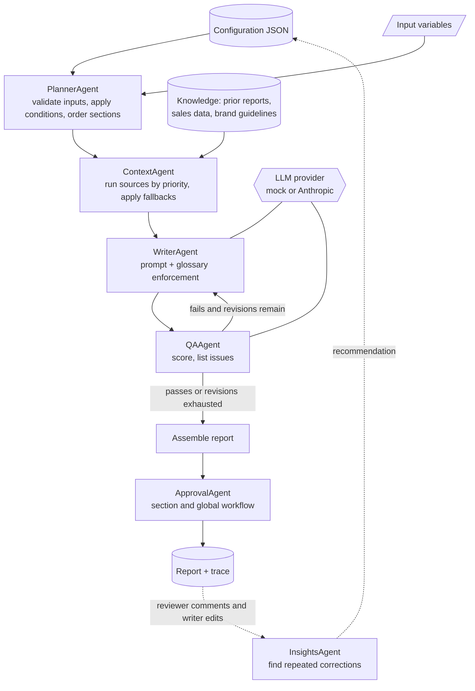

# Architecture

Diva Atelier AI generates dress and fashion reports from a **configuration**. A configuration is the
JSON document the dashboard edits: input variables, a tree of sections, and for each section its
writing instructions, retrieval sources, style and tone, quality bar and approvers.

The code is a small team of single-purpose agents run by an orchestrator. Each agent has one job, a
typed input and output, and writes to a shared event log, so every report carries a trace of what
happened and why.

Sections are independent once the plan exists, so they run in parallel (`max_workers`, default 4).
Results are reassembled in plan order.

## The agents

| Agent | Input | Output | Key rules |
| --- | --- | --- | --- |
| `PlannerAgent` | configuration, variables | `Plan` of included and excluded sections | Validates every variable by type (dates, ranges, selections, numbers). A section is included only if its parent is included and its condition holds. Children are ordered by `seq` under their parent. |
| `ContextAgent` | section, variables | `ContextBundle` of snippets, warnings, escalate flag | Renders `{variables}` into each source query and runs sources by `priority`. An empty source applies its fallback: `GenerateWithoutContext`, `Warn`, `Skip`, `UseDefault` or `Escalate`. A query with an unset variable is skipped, never searched literally. |
| `WriterAgent` | section, variables, context, revision notes | `Draft` | Builds the system prompt from style and tone. **Preferred terminology is enforced in code after generation**, so the house glossary never depends on the model obeying it. |
| `QAAgent` | section, draft | `QAResult` (score 0-100, dimension scores, issues) | Deterministic checks always run: empty text, unresolved `{placeholders}`, paragraph limit, missing table, glossary violations, figures not found in the context, checklist coverage. An optional LLM judge is averaged in. A critical issue fails the section whatever the score. |
| `ApprovalAgent` | configuration, section results | `ApprovalWorkflow` | Ordered section approvals, then global approvals. Optional auto-approve. Authors cannot approve their own report; rejecting needs a comment. |
| `InsightsAgent` | configuration, feedback | `Recommendation` list | Finds repeated corrections and proposes the exact configuration change. See below. |

`ReportOrchestrator` wires them together. For each section it loops: write, review, and if QA fails
and revisions remain, write again with QA's issues attached as revision notes. A section that never
passes is marked `needs_review` and kept visible. It is never silently dropped or silently passed.

### Section and report statuses

`passed`, `needs_review` (QA still failing after revisions), `escalated` (a required source was empty),
`manual` (not AI-generatable), `failed` (the model call errored; other sections are unaffected).
A report is `ready_for_review` only when every included section is `passed`.

## The feedback loop (Configuration Insights)

When people keep fixing the same thing, the configuration should change, not the next draft.
`InsightsAgent` reads stored comments and edits and proposes edits to the configuration:

* **Terminology.** The same word or phrase replaced in several edits, or "use 'x' not 'y'" comments
  → add to the section's `preferredTerminology`.
* **Required content.** The same sentence appended to a section in several reports → add a standing
  requirement to its writing instructions.
* **Paragraph limit.** Repeated comments that a limit is too tight → raise `maxParagraphs`.

Detection is deterministic (word diffs and token overlap) so every recommendation can be explained
and tested. Each carries its evidence (`patternBasis`, `feedbackThread`) and a confidence that grows
with the number of occurrences. Accepting one (`POST .../insights/<id>/apply`) writes the change,
bumps the configuration version, resets its status to `Draft` so it is reviewed, and marks the
feedback as consumed so it is not proposed again.

## Providers

`LLMClient` is a one-method protocol. Two implementations ship:

* `MockLLM` is offline and deterministic. It composes text from instructions and context and is a
  stand-in for the pipeline, not a language model. It is what the tests and the demo use.
* `AnthropicClient` calls the Messages API over HTTPS using only the standard library, with retry and
  exponential backoff on 408, 409, 429, 500-504 and 529. It is tested against a local stub server.

Retrieval is also a protocol (`Retriever`). `InMemoryRetriever` is a lexical approximation (query
coverage and TF-IDF cosine) good enough for local use. For production, implement `Retriever` on your
vector database.

## Design decisions

* **Standard library only.** No runtime dependencies to install, audit or break. The cost is a simple
  HTTP server (`http.server`) rather than an async framework; see "Production notes" in the README.
* **Configuration is data.** Behaviour is changed by editing JSON, which is what the dashboard does,
  rather than by editing prompts in code.
* **Never hide a failure.** Failed, escalated and under-quality sections stay in the report with a
  status and a reason, and the report status reflects the worst section.
* **Deterministic guardrails around a probabilistic model.** Terminology, paragraph limits,
  placeholders and tables are checked in code.
